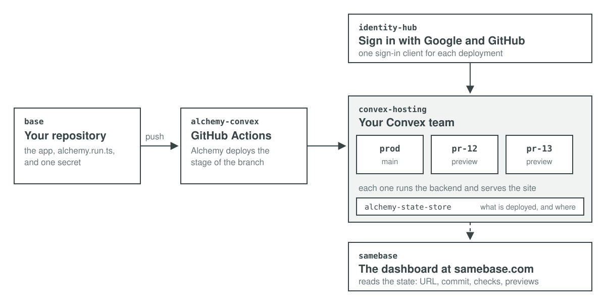

## A dashboard for Alchemy

[samebase.com](https://samebase.com) reads the state that [Alchemy](https://alchemy.run) keeps and
shows every app you deploy: its URL, the deployed commit, its checks, and the preview of each pull
request. The repositories here are the dashboard, a starter that deploys a new app with one secret,
and the packages built along the way.

<picture>
  <source media="(prefers-color-scheme: dark)" srcset="https://raw.githubusercontent.com/samebase/.github/main/profile/map-dark.svg">
  
</picture>

Alchemy is the fixed part: one file, `alchemy.run.ts`, describes the app, and GitHub Actions deploys
it. [Convex](https://convex.dev) is the starter's default: it runs the backend, serves the site, and
holds the Alchemy state. The starter's interface is React with TanStack Start today, and it is the
replaceable part: an agent can rewrite it for another framework.

### The four repositories

- **[samebase](https://github.com/samebase/samebase): the dashboard and the packages.** The source
  of [samebase.com](https://samebase.com). It shows the Alchemy stacks of each repository you
  connect, from state kept in a Convex project, in Cloudflare, or on a branch of the repository.
- **[base](https://github.com/samebase/base): start an app.** The starter template. Add one secret,
  `CONVEX_ACCESS_TOKEN`, and push. About a minute later the app is live, with pull request
  previews and Google sign-in. No Samebase account.
- **[identity-hub](https://github.com/samebase/identity-hub): sign-in for every deployment.**
  Google and GitHub want each callback URL registered by hand, so a preview cannot sign in. The hub
  registers each deployment when it deploys. Use ours at `id.samebase.com`, or run your own from
  this template.
- **[convex-hosting](https://github.com/samebase/convex-hosting): one host.** A Convex component
  that serves the app's files and its server-rendered pages from the deployment that runs the
  backend.

### The packages

- [`@samebase/alchemy-convex`](https://github.com/samebase/samebase/tree/main/packages/alchemy-convex):
  Convex for Alchemy. Projects, deployments, environment variables, the push, and the Alchemy state
  in your own Convex team.
- [`@samebase/alchemy-kit`](https://github.com/samebase/samebase/tree/main/packages/alchemy-kit):
  parts for Alchemy. State on a branch of your GitHub repository with sealed secrets, and a run
  record in each stage output.
- [`@samebase/identity-broker`](https://www.convex.dev/components/samebase/identity-broker): an
  OpenID Provider as a Convex component. The identity hub is this package plus settings.
- [`@samebase/convex-hosting`](https://www.convex.dev/components/samebase/convex-hosting): the
  hosting component.
- [`@samebase/sidebars`](https://github.com/samebase/samebase/tree/main/packages/sidebars): the
  unstyled React sidebar layout of samebase.com.

[samebase.com](https://samebase.com) · [Discord](https://samebase.com/discord) ·
[X](https://x.com/samebasecom)
